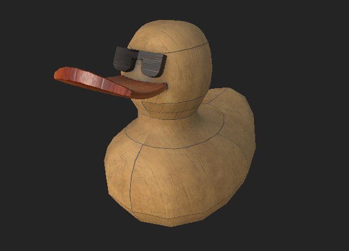
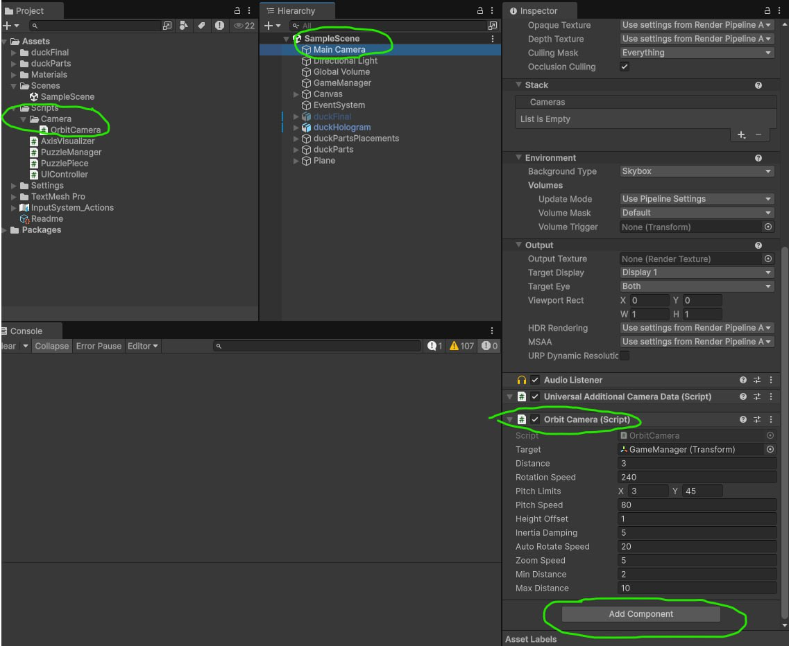
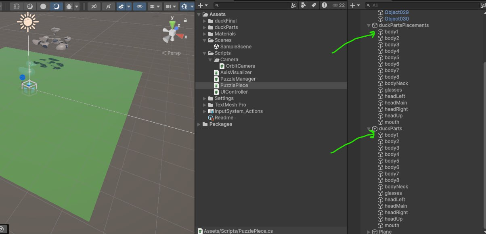
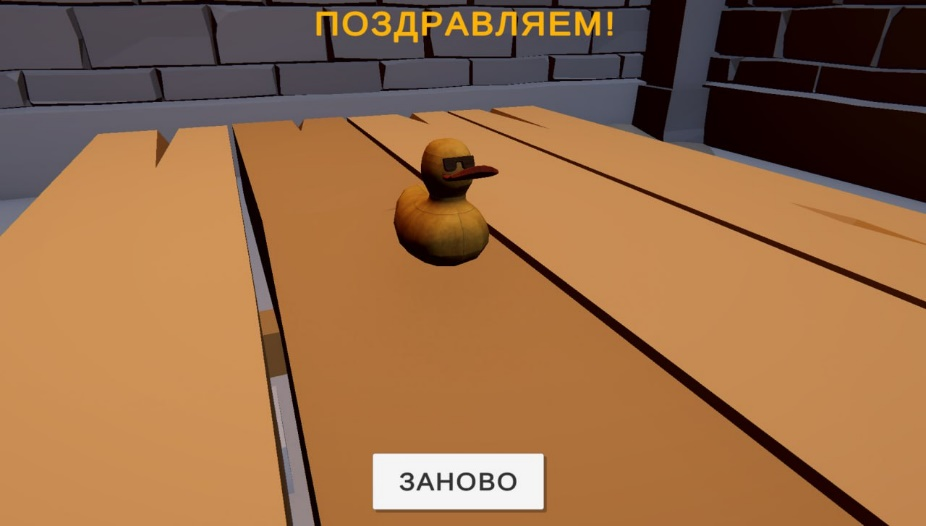

# 3D-пазл «Утка»

A Unity 3D puzzle game: the player assembles a duck model from separate parts.

Курсовая работа по дисциплине «Компьютерная графика» (2025). Автор: София Родионова, Миасский филиал ЧелГУ.

## Цель

Создать мини-игру в жанре 3D-пазл, в которой игрок собирает модель утки из отдельных частей: от моделирования и текстур до игровой механики и интерфейса в Unity.

## Что реализовано

Игровая механика (скрипты из приложений к курсовой):

- **PuzzlePiece** — перетаскивание детали мышью в плоскости цели, «примагничивание» при достаточной близости по позиции и углу, зависимость от уже установленных соседей (следующую часть можно поставить, только если рядом есть хотя бы одна установленная).
- **PuzzleManager** — регистрация деталей, случайная установка одной стартовой части, проверка полной сборки, переключение голограммы на собранную модель, сигнал победы в UI и запуск автоповорота камеры.
- **UIController** — стартовая панель, игровой интерфейс, экран победы, кнопки старта и перезапуска сцены. В тексте работы также упоминается кнопка принудительной сборки (`FakeComplete` в менеджере).

Модель и сцена (по тексту работы и скриншотам редактора, сами ассеты в приложениях не приложены):

- 3D-модель утки, разбитая на части (`body1`–`body8`, `bodyNeck`, `glasses`, `headLeft`, `headMain`, `headRight`, `headUp`, `mouth`);
- целевые трансформы в `duckPartsPlacements` (копия модели, чтобы детали «знали» своё место);
- голограмма (`duckHologram`) и финальная модель (`duckFinal`);
- пайплайн модели: 3ds Max, Substance Painter, UV 1024×1024, texel density 512 px/м, PBR-карты (Albedo, Metallic/Smoothness, Normal, AO) в PNG; размер каждой текстурной карты — не больше 1,5 МБ (требование к мобильной платформе);
- деревянный ящик и окружение моделировались в Blender;
- обмен моделями в формате FBX;
- скриншот редактора показывает Universal Render Pipeline (URP).

## Стек

Unity 3D (URP), C#, 3ds Max, Substance Painter, Blender, FBX, PBR.

## Результаты

Количественных метрик (время сборки, число уровней и т. п.) в отчёте нет. Зафиксировано следующее:

- пройден полный цикл: модель, материалы, интеграция в Unity, управление и UI;
- получен законченный прототип мини-игры со стартовым экраном, сборкой и экраном «Поздравляем!»;
- текстуры уложились в ограничение «не больше 1,5 МБ» на карту.

## Скриншоты

Тестовый рендер модели утки.

Сцена в редакторе Unity и скрипт орбитальной камеры.

Части пазла и их целевые позиции.

Экран завершения сборки.

## Состав репозитория и чего не хватает

В приложениях 1–3 приведены три скрипта: `PuzzleManager`, `PuzzlePiece`, `UIController`. Они лежат в `Assets/Scripts/`, как на скриншотах проекта.

**Не хватает исходников**, которые видны в работе и на скриншотах редактора, но в приложения не вошли:

- `OrbitCamera` (в иерархии — `Assets/Scripts/Camera/OrbitCamera`; в коде к нему обращаются `StartAutoRotation()` и флаг `IsInteractingWithPiece`);
- `AxisVisualizer`;
- сцена `SampleScene`, модели, материалы, префабы, UI-канвас и настройки проекта Unity.

Без сцены и ассетов проект в редакторе не открыть как готовую игру: есть только логика скриптов.

При извлечении из Word исправлены только артефакты вёрстки: типографское тире в `[DefaultExecutionOrder(-100)]` и потерянные операторы `||` в двух условиях (`isHeld || IsSnapped`, `!targetPoint || IsSnapped`). Остальной код сохранён как в приложении, включая вызов `rb.linearVelocity` (API новых версий Unity).

## Как запустить

1. Установить Unity с поддержкой URP (по скриншотам проект уже на Universal RP).
2. Создать или открыть Unity-проект и скопировать скрипты в `Assets/Scripts`.
3. Восстановить сцену: модель утки и целевые точки, компоненты `PuzzlePiece` на деталях, `PuzzleManager` на объекте сцены, `UIController` на канвасе, `OrbitCamera` на камере (скрипт камеры в этот репозиторий добавить отдельно — его не было в приложениях).
4. Запустить `SampleScene`. Управление: вращение камеры вокруг сцены, перетаскивание деталей мышью; деталь встаёт на место, если достаточно близко и есть установленный сосед.

## Лицензия

MIT, Sofia Rodionova, 2026.
